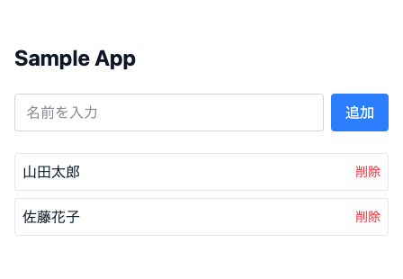

# intern-web-app-assignment-template-2026-summer


2026年夏 長期インターン選考プログラムの課題（デモシステム開発）用テンプレート。FastAPI（Python）+ Next.jsを環境構築しただけの状態に、動作確認用のサンプルCRUD（`Sample`: `id`・`name`のみ）を1つ置いてある。

課題の実装（機能追加）はこのサンプルを参考にしながら、`backend/app/main.py`・`frontend/app/src/app/page.tsx`に書き足していく想定。認証・認可機能・lint・テスト・CIは実装していない。

> **前提**: このページを見ているということは、配布された「テンプレートを自分のGitHubリポジトリにする手順」PDFの手順（ZIP展開→GitHubへのpush）は完了済みのはず。まだの場合は先にそちらを行うこと。

## 構成

| ディレクトリ | 内容 |
|---|---|
| [`backend/`](./backend/README.md) | FastAPI（Python）ベースのバックエンド |
| [`frontend/`](./frontend/README.md) | Next.js（App Router）ベースのフロントエンド |
| [`docs/`](./docs) | 選考プログラム案内・課題内容・環境構築ガイドなどの配布資料（PDF） |

`docs/`の内訳:

| ファイル | 内容 |
|---|---|
| [`selection-program-guide.pdf`](./docs/selection-program-guide.pdf) | 長期インターン選考プログラムの案内 |
| [`assignment-brief.pdf`](./docs/assignment-brief.pdf) | 課題内容（デモシステム開発提案） |
| [`repository-setup-guide.pdf`](./docs/repository-setup-guide.pdf) | このテンプレートを自分のGitHubリポジトリにする手順 |

[`draft/`](./docs/draft)には各PDFのHTML原稿を置いている。配布物ではなく、内容を修正するときの編集用ドラフト。

- UI: Tailwind CSSのみ（コンポーネントライブラリは使わない）
- 通信: フロントエンドは素の`fetch`でバックエンドAPIを呼ぶ（ライブラリなし）

## 必要なツール（インストールと確認）

以下を順にインストールする。それぞれ「これができればOK」というゴールも書いておく。

### 1. VS Code（または Cursor）

- [VS Codeをダウンロード](https://code.visualstudio.com/download)してインストールする（[Cursor](https://cursor.com/downloads)でも可）
- 起動したら、左端のアイコン一覧から拡張機能（四角が4つ並んだアイコン）を開き、**「Dev Containers」**（発行元: Microsoft）を検索してインストールする（[拡張機能ページ](https://marketplace.visualstudio.com/items?itemName=ms-vscode-remote.remote-containers)）
- **ゴール**: VS Codeの拡張機能一覧に「Dev Containers」が入っている状態
- Python用（Pylance等）・フロントエンド用（Tailwind CSS IntelliSense等）の拡張機能は、後述の「Reopen in Container」でコンテナ内に自動インストールされる。自分で個別に入れる必要はない

### 2. Docker Desktop

- [Docker Desktopをダウンロード](https://www.docker.com/products/docker-desktop/)してインストールする
- インストール後に**起動しておく**（このアプリはバックグラウンドで常駐させておく必要がある。Macなら画面上部のメニューバー、Windowsならタスクバーの通知領域にクジラのアイコンが出ていれば起動中）
- **ゴール**: ターミナルで`docker --version`を実行してバージョンが表示される。かつDocker Desktopのアプリが起動している（アイコンがグレーアウトしていない）

AIツール（Claude Code等）の利用は自由。ただし生成されたコードの内容を自分で理解した状態で提出すること。

このリポジトリは既に自分のGitHubアカウント上にある前提（ZIPからのセットアップ手順は別途配布した資料を参照）。

## 環境構築手順

1. 自分のリポジトリをまだ手元に持っていない場合はclone: `git clone <自分のリポジトリのURL>`
2. VS Code（または Cursor）でそのフォルダを開く（メニューの「ファイル」→「フォルダーを開く」）
3. Docker Desktopが起動していることを確認してから、画面左下の `><` アイコンをクリックし、**「Reopen in Container」**を選ぶ
   - `backend`と`frontend`それぞれにDevContainerの設定があるので、まず片方（例: `frontend`）を選んで開く。もう片方も並行して触りたい場合は、別のVS Codeウィンドウでもう一度同じ手順を行うか、次のコマンドで両方まとめて起動する
4. コンテナをコマンドでまとめて起動したい場合は、VS Codeのターミナル（またはGit Bash/ターミナル.app）でリポジトリ直下から以下を実行する

   ```bash
   docker compose -f docker-compose.backend.yml -f docker-compose.frontend.yml up
   ```

`environments/.env.local`はローカル専用のダミー値のみを含むためリポジトリに含まれており、追加設定なしで起動できる。

### 動作確認

初回はイメージのビルドに数分かかる。起動できたら、ブラウザで以下を開いて確認する。

| 確認先 | 見えるべきもの |
|---|---|
| http://localhost:3000 | ログイン画面が表示され、パスワード入力後に問い合わせ一覧が表示される |
| http://localhost:8000 | `{"status":"healthy"}` という文字が表示される |
| http://localhost:8000/docs | Swagger UI（APIの仕様一覧）が表示される |

http://localhost:3000 はこのような画面になる（名前を追加・削除できるだけのシンプルなサンプル）:



うまく表示されない場合は、まずDocker Desktopが起動しているか、上記コマンドやVS Codeの「Dev Containers」ログにエラーが出ていないかを確認する。

起動後のサービス一覧:

| サービス | URL | 補足 |
|---|---|---|
| フロントエンド（Next.js） | http://localhost:3000 | |
| バックエンド（FastAPI） | http://localhost:8000 | |
| Swagger UI（API仕様） | http://localhost:8000/docs | |
| MySQL | localhost:3306 | user/password（`docker-compose.backend.yml`参照） |

## 社内問い合わせ管理システム（課題の実装）

現場スタッフ（入園ゲート・特設ブース・チケット窓口など）とサポートチームが使う社内向けの問い合わせツール。サイトは**現場スタッフ用（`/staff`）**と**サポートチーム用（`/support`）**に分かれている。http://localhost:3000 を開くとログイン画面が出るので、先に「現場スタッフ」「サポートチーム」のどちらかを選び、そのサイトのパスワードを入力する。

### ログイン（サイトごとのパスワード）

- パスワードは4種類。**現場スタッフ用**（初期値`000`）は現場スタッフ用サイト（`/staff`）だけ、**サポートチーム用**（初期値`111`）はサポートチーム用サイト（`/support`）だけに入れる。管理者はサイトごとに別で、**現場スタッフ管理者パスワード**と**サポートチーム管理者パスワード**がある。ログイン画面で自分のサイトを選んで管理者パスワードを入力すると、そのサイトの管理者としてログインする（ヘッダーに「管理者」と表示される）
- 相手側のサイトのパスワードでは入れない。ログイン後に相手側のサイトや入口（`/`）を開くと、自分のサイトへ移動する。API もサイトごとに制限している（現場スタッフは問い合わせの一覧・編集・削除・設定の変更・ステータス変更ができず、サポートチームを名乗った返信もできない）
- パスワードの変更は**各サイトの管理者のみ**で、変更できるのは自分のサイトのものだけ。現場スタッフ管理者は現場スタッフ用の「設定」画面（`/staff/settings`。管理者にだけメニューが出る）から現場スタッフ用・現場スタッフ管理者のパスワードを、サポートチーム管理者はサポートチーム用の「設定」画面（`/support/settings`）からサポートチーム用・サポートチーム管理者のパスワードを変更できる（本人確認のため自分の現在の管理者パスワードが必要。同じサイトの別のパスワードと同じにはできない）。変更すると、変更した管理者以外はそのサイトの全員がログアウトされる（相手側のサイトには影響しない）。管理者以外では変更画面が表示されず、相手側のサイトのパスワードを含めAPIも403を返す
- パスワードはハッシュ化（PBKDF2）してDBに保存している。初期値は`backend/environments/.env.secret`（Git管理外）の`APP_PASSWORD`（現場スタッフ用）・`SUPPORT_PASSWORD`（サポートチーム用）・`STAFF_ADMIN_PASSWORD`（現場スタッフ管理者）・`SUPPORT_ADMIN_PASSWORD`（サポートチーム管理者。旧名`ADMIN_PASSWORD`でも可）から作られ、DBに保存された後は画面で変更した値が使われる
- 未ログインの場合、画面だけでなくAPI（`/`のヘルスチェックとログイン以外すべて）も401を返すので、Swagger UIから直接データを見ることもできない
- ログイン状態はHttpOnly Cookieで12時間保持（`SESSION_HOURS`で変更可）。同じ接続元から5回続けて間違えると10分間ログインできなくなる
- HTTPSで公開する場合は`COOKIE_SECURE='true'`を設定する

### 画面

| URL | 内容 |
|---|---|
| `/` | 入口。ログインしたパスワードのサイトへ自動で移動する |
| `/login` | ログイン画面。先に「現場スタッフ」「サポートチーム」を選び、そのサイトのパスワードを入力する（「表示」で入力中の文字を確認できる。通知や QR コードのリンクから開いた場合は、行き先のサイトが選ばれた状態になる） |

**現場スタッフ用（`/staff`）**

| URL | 内容 |
|---|---|
| `/staff` | かんたん問い合わせ（AIチャット）。来場者対応中の職員がAIにチャットで質問できる。📷ボタンから「カメラで撮影」「アルバムから選ぶ」「ファイルから選ぶ」を選んで、エラー画面などの写真を1回4枚まで貼付でき（送信前に長辺1600pxに縮小）、AIが写真の内容も読み取って答える。該当するよくある質問（FAQ）があれば出典つきで引用する。AIで解決できないと判断されたら（または職員が「解決しない」を押したら）、会話ごとサポートチームへ送信する。送信フォームを開いた時点でチャットの内容と必須項目を照合し、足りない項目（予約番号・チケット種別など）をその場で入力欄として聞き出す（わからない項目は空欄のまま送れ、「不明」として伝わる）。使った名前は端末に記憶して選べる。`/staff?name=入園ゲート%20田中`で名前を事前入力できるので、持ち場ごとのQRコードにすると便利 |
| `/staff/new` | フォームで問い合わせる（必須項目をすべて書く通常の入力）。発生日時はカレンダーから選べる（「今」ボタンで現在の日時）。入力が止まると2秒後にAIが必須項目の不足をその場で指摘する |
| `/staff/inquiries` | 送った問い合わせ。この端末から送った問い合わせの一覧で、サポートチームから回答が来たものには「回答あり」、追加の情報を求められているものには「追加の情報を待っています」と表示される |
| `/staff/inquiries/{id}` | 問い合わせの状況・やり取りの確認と、サポートチームへの返信（定型文・写真の貼付つき） |

**サポートチーム用（`/support`）**

| URL | 内容 |
|---|---|
| `/support` | 一覧・キーワード検索（スペース区切りでAND・部分一致。全角/半角の違いも吸収）、並び順（新しい順・古い順・更新順）、ステータスの絞り込み、各問い合わせの「返信する」ボタン |
| `/support/inquiries/{id}` | 詳細・編集・削除、返信（定型文つき。📷から「カメラで撮影」「アルバムから選ぶ」「ファイルから選ぶ」で写真も貼付できる。ステータスは返信欄の「送信後のステータス」で変える）、やり取りの履歴 |
| `/staff/settings` | パスワードの変更（現場スタッフ管理者のみ。メニューも管理者にだけ表示） |
| `/support/settings` | パスワードの変更（サポートチーム管理者のみ）、必須項目の追加・無効化・削除、FAQの取り込み状況、要約の作成 |

- 🔔の通知は、開いているサイトの宛先（現場スタッフ用なら現場スタッフ宛、サポートチーム用ならサポートチーム宛）で表示され、タップするとそのサイトの詳細画面が開く。ポップアップ通知も同じ
- 分ける前のURL（`/quick`・`/inquiries/{id}`・`/inquiries/new`・`/settings`）は、新しいURLへ自動で移動する（持ち場に貼ったQRコード `/quick?name=...` もそのまま使える）

### 画面のデザイン

- 白に近い背景に、水色と白をベースにした寒色系（水色・アクア・ミント・ラベンダー）を合わせた配色。色の定義は`frontend/app/src/styles/globals.css`にまとめている。文字は背景に対して十分なコントラストを確保している
- ゴシック体（Noto Sans JP。読み込めない環境では端末のゴシック体）と角の丸いボタン・カードで、やわらかい印象にしている
- ログイン画面の「表示」ボタンで、入力中のパスワードを確認できる
- 名前記入欄（新規作成・かんたん問い合わせ・返信）は、この端末で使った名前を最大10件覚えて下に並べ、タップで選べる（×で候補から消せる）
- 画面の切り替え・一覧・チャットの吹き出し・メニューなどになめらかなアニメーション。端末で「視差効果を減らす」を設定している場合は動きを止める
- 一画面の情報量を減らすため、絞り込み・AIの判定・定型文・編集／削除などは必要なときだけ開く形にしている

### 写真の添付

- チャットで貼付した写真は、サポートチームへ送るとその問い合わせに添付され、詳細画面にサムネイルで表示される（タップで拡大）
- サーバー側で、申告された形式ではなくファイルの中身（先頭のバイト列）から JPEG・PNG・GIF・WebP かどうかを判定し、それ以外や5MBを超えるものは受け付けない
- 写真の表示にもログインが必要。問い合わせを削除すると写真も削除される

### すぐ返信するための仕組み

- AIチャットから送られた問い合わせは、職員への自動の聞き返しをせず、サポートチームがそのまま送れる返信の下書き（不足情報の確認、または一次回答）を用意しておく
- 詳細画面の上部に返信欄がある（AIの回答案は入れず、サポートチームが自分で書く）。定型文ボタン、写真の貼付、Ctrl+Enterでの送信、送信後のステータス自動設定（初回回答で「一次回答提示済み」）に対応
- 一覧の「返信する」ボタンや🔔の通知から開くと、返信欄にカーソルが入った状態で開く
- 詳細画面は15秒ごとに自動更新され、相手の返信がすぐ表示される

### よくある質問（FAQ）の引用

- AIチャットの回答と、問い合わせへの一次回答の下書きで、該当するFAQがあれば本文と出典URLを引用する。参照元は https://support.terravie.co.jp/faq/
- FAQはバックエンドが参照元のサイトから取り込んでDBに保存している（起動時に未取得・1日以上経過していれば取り込み、以後は毎日の要約バッチと一緒に取り込み直す。相手のサーバーに負荷をかけないよう1件ずつ1秒あけて取得する）
- 引用する本文とURLはDBの内容をそのまま使う（AIには該当するFAQの番号だけを答えさせるので、AIが引用を書き換えたりURLを作ったりすることはない）
- APIキーが無い場合は、文字の一致度（出現の少ない語を重く数える）で最も近いFAQを探して引用する
- 設定画面で取り込み件数と日時を確認でき、サポートチーム管理者は「今すぐ取り込む」で取り込み直せる

### 通知

画面右上の🔔に未読数が出る（15秒ごとに確認）。開いているサイトの宛先（現場スタッフ用／サポートチーム用）の通知が表示される。

**サイトを開いているとき**：新しい通知が届くと、画面右上にポップアップが出る（10秒で自動的に消える。タップでその問い合わせの返信欄が開く）。ポップアップ通知がオンなら届いた瞬間に、オフでも10秒以内に表示される。操作中の画面では画面内のポップアップだけを出し、別のタブやウィンドウを見ているときはOSの通知でも知らせる。

**ポップアップ通知（サイトを閉じているとき）**：🔔の中の「ポップアップ通知」をオンにすると、サイトを閉じていてもOSの通知として届く（Web Push）。通知をタップすると、その問い合わせの返信欄が開く。

- パソコン（Chrome・Edge）: ブラウザが起動していれば（ウィンドウを閉じていても常駐していれば）届く
- スマートフォン: HTTPSで公開したサイトを「ホーム画面に追加」してアプリとして開き、そこで通知をオンにする（iPhoneはiOS 16.4以降）。`localhost`では動かないため、実機で使うには本番環境（HTTPS）が必要
- 送信に使う鍵（VAPID）は初回に自動で作ってDBに保存するので、設定は不要

| 宛先 | 通知されるタイミング |
|---|---|
| サポートチーム | 新しい問い合わせ、AIで解決できずチャットから送られた問い合わせ、職員からの返信 |
| 現場スタッフ | サポートチームからの回答、AIからの追加確認 |

Slack・Teams などにも送りたい場合は、`.env.secret`に`NOTIFY_WEBHOOK_URL`（Incoming WebhookのURL）を書いてバックエンドを再起動する。

### 必須項目（初期設定）

発生日時・再現手順・利用端末・予約番号／注文番号・チケット種別（入園券・ツアー・年間パスなど）・発生場所（入園ゲート・特設ブースなど）。`/settings`で変更できる。

### よくある事例（想定原因のパターン）

`backend/app/park_cases.py`に「QRが読み取れない」「顔写真が登録できない」「決済が完了しない」「チケットが表示されない」「ログインできない」の事例と、考えられる原因・案内文を定義している。AIはこれを参考に一次回答を作り、AIが使えない場合もキーワードで事例を判定して一次回答の下書きを出す。実際の運用に合わせてこのファイルを編集する。

### ステータスとAIの流れ

1. 問い合わせを作成すると、AIが必須項目と照合する
2. 不足あり → AIが追加確認事項をコメントで自動投稿し、ステータスを「情報待ち」にする
3. 現場スタッフが返信すると自動で再チェックし、揃えば「未対応」に戻して一次回答の下書きを作る
4. サポートチームが下書きを確認・修正して送信すると「一次回答提示済み」になる
5. 対応が終わったら「対応完了」にする

### AI（Claude API）の設定

`backend/environments/.env.secret`にAPIキーを書いてバックエンドを再起動する。このファイルはGit管理外なのでGitHubには公開されない（`.env.local`はコミットされるのでキーを書かないこと）。

```
ANTHROPIC_API_KEY='sk-ant-...'
```

APIキーが無い場合やAPIエラー時は、必須項目ごとの「簡易判定キーワード」で判定するルールベースで動く（画面に「キーワード簡易判定」と表示される）。使うモデルは`.env.local`の`ANTHROPIC_MODEL`で変更できる。

### 自動要約バッチ

バックエンド起動中は毎日`SUMMARY_BATCH_HOUR`時（既定: 3時）に、要約が未作成または要約後に更新された問い合わせを要約する。すぐ実行したい場合は一覧画面のリンク、`POST /batch/summaries`、またはバックエンドコンテナ内で`python batch.py`を使う。

### ファイル構成

| ファイル | 内容 |
|---|---|
| `backend/app/main.py` | APIエンドポイント |
| `backend/app/models.py` / `schemas.py` | DBテーブル定義 / APIの入出力の型 |
| `backend/app/ai_service.py` | AIチェック・一次回答・要約（Claude API とルールベースのフォールバック） |
| `backend/app/park_cases.py` | パークでよくある事例（想定原因・案内文） |
| `backend/app/auth.py` | 共通パスワードによるログイン・パスワード変更 |
| `backend/app/notifications.py` | 通知（画面のベル・Webhook） |
| `backend/app/batch.py` | 日次の自動要約バッチ |
| `backend/app/alembic/versions/c3a1f0e2d7b9_add_inquiry_tables.py` | テーブル作成と必須項目の初期データ |
| `backend/app/alembic/versions/d5b2e8f4a1c6_park_required_fields.py` | 必須項目をパーク向けに変更 |
| `backend/app/alembic/versions/e7c3a9d1b2f5_urgency_notifications_settings.py` | 緊急度・通知・設定テーブルの追加 |
| `backend/app/alembic/versions/f9d4b6e2c8a3_remove_urgency.py` | 緊急度フラグの廃止 |
| `backend/app/alembic/versions/a1e5c7f3d9b4_add_attachments.py` | 写真の添付テーブルの追加 |
| `backend/app/images.py` | 貼付された写真の検証 |
| `backend/app/push.py` | ポップアップ通知（Web Push）の送信 |
| `backend/app/alembic/versions/b3f6d8a2e4c7_read_receipts_and_push.py` | 既読の記録（のちに廃止）・ポップアップ通知の送り先の追加 |
| `backend/app/alembic/versions/c5a7e9b1d3f8_faq_and_remove_read.py` | FAQテーブルの追加・既読の記録の廃止 |
| `backend/app/faq.py` | よくある質問の取り込み・検索・引用 |
| `frontend/app/public/sw.js` | ポップアップ通知を受け取るサービスワーカー |
| `frontend/app/src/components/NameField.tsx` | 使った名前を選べる名前記入欄 |
| `frontend/app/src/styles/globals.css` | カラーパレット・共通の部品・アニメーション |
| `frontend/app/src/app/` | 各画面 |
| `frontend/app/src/lib/api.ts` | APIの型とfetchヘルパー |

## サンプルAPI

`GET/POST /samples`・`DELETE /samples/{id}`の3本（`backend/app/main.py`）。Swagger UIから動作確認できる。

## 学習リソース（初めての方向け）

このテンプレートは各フレームワークの公式ドキュメントに準拠した最小構成にしている。迷ったら、まず公式のチュートリアルを参照する。

| リソース | 内容 |
|---|---|
| [Next.js Learn](https://nextjs.org/learn) | Next.js公式のハンズオン学習コース |
| [FastAPIチュートリアル](https://fastapi.tiangolo.com/tutorial/) | FastAPI公式チュートリアル（DB連携まで含む） |
| [Git入門（GitHub公式）](https://docs.github.com/ja/get-started/using-git/about-git) | Gitの基本操作 |
| [Docker Desktopの使い方](https://docs.docker.com/get-started/) | Docker/コンテナの基本 |
